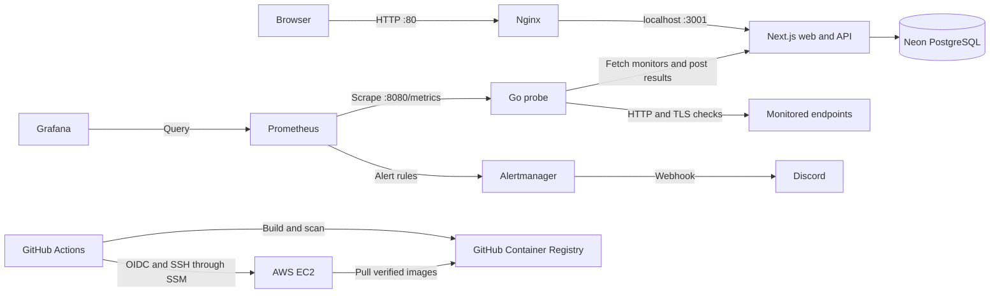

# Polo | Uptime Monitoring Platform

Polo monitors HTTP endpoints, records availability and response latency, checks TLS
certificate expiry, and sends incident alerts to Discord. A Go worker runs the
checks; a Next.js dashboard and PostgreSQL database store and display the results.

This repository also contains the Docker, monitoring, Terraform, and GitHub Actions
configuration used to deploy the platform to an AWS EC2 instance.

## Architecture



Nginx runs on the EC2 host. The five application and monitoring services run in
Docker Compose. PostgreSQL is hosted separately in Neon.

## Features and current scope

- Concurrent Go checks with bounded workers, timeouts, graceful shutdown, and a
  configurable scan interval, defaulting to 60 seconds.
- Monitor creation and deletion, current status, latency, TLS expiry, and incident
  history in the web dashboard. Dashboard timestamps display in IST.
- Prometheus metrics, Grafana visualizations, and native Alertmanager Discord alerts.
- Multi-stage images with non-root application containers and health checks.
- Terraform-managed AWS networking, EC2, IAM, and GitHub OIDC authentication.
- CI checks, Trivy HIGH/CRITICAL vulnerability gates, GHCR publication, and verified
  EC2 deployment through AWS Systems Manager.

The deployed demo uses Nginx over HTTP. HTTPS has not been configured. The web
API currently has no authentication, including its write endpoints. Treat this as
a learning/demo deployment; add access control and HTTPS before broader use.
Target URL validation is not an SSRF boundary: restrict who can create monitors
and what networks the probe can reach.

## Repository layout

| Path | Purpose |
| --- | --- |
| [`web/`](web/) | Next.js dashboard, API, and PostgreSQL initialization |
| [`probe/`](probe/) | Go probe, metrics, Dockerfile, and tests |
| [`monitoring/`](monitoring/) | Prometheus rules, Alertmanager, and Grafana data source |
| [`infra/`](infra/) | Terraform AWS resources and EC2 bootstrap script |
| [`scripts/deploy/`](scripts/deploy/) | Release packaging, SSH setup, deployment, and verification |
| [`scripts/remove-state-bucket.ps1`](scripts/remove-state-bucket.ps1) | Separate cleanup of the versioned Terraform state bucket |
| [`docker-compose.yml`](docker-compose.yml) | Local stack with application image builds |
| [`docker-compose.prod.yml`](docker-compose.prod.yml) | EC2 stack using published application images |
| [`.github/workflows/deploy.yml`](.github/workflows/deploy.yml) | Build, scan, publish, and deploy pipeline |
| [`.github/workflows/deployment-access.yml`](.github/workflows/deployment-access.yml) | Manual AWS/SSM/SSH access test |

## Run locally with Docker Compose

Install Git and Docker with Compose. On Windows, use Docker Desktop with Linux
containers. Obtain a PostgreSQL connection string and a Discord webhook.

The following commands use PowerShell from the repository root:

```powershell
git clone https://github.com/NaveenGumaste/polo-uptime-monitoring-platform.git
Set-Location polo-uptime-monitoring-platform
Copy-Item web/.env.example web/.env
notepad web/.env
notepad monitoring/.env.discord-webhook
```

Set `DATABASE_URL` in `web/.env`. Put only the complete Discord webhook URL in
`monitoring/.env.discord-webhook`, with no variable name or surrounding quotes.
Both files are ignored by Git. Never commit real connection strings or webhooks.

```powershell
docker compose --env-file ./web/.env up --build -d --wait
docker compose --env-file ./web/.env ps
curl.exe -i http://localhost:3001/api/monitors
curl.exe -i http://localhost:8082/health
```

The first API request creates the database tables and seeds three example monitors
if the monitor table is empty. The intentionally failing example may return an
HTTP error or EOF; either is recorded as DOWN.

| Service | Local address |
| --- | --- |
| Dashboard and API | http://localhost:3001 |
| Probe health / metrics | http://localhost:8082/health / http://localhost:8082/metrics |
| Prometheus | http://localhost:9090 |
| Alertmanager | http://localhost:9093 |
| Grafana | http://localhost:3002 |

All published Compose ports bind to `127.0.0.1`. The local Grafana instance uses
its first-login setup; change the initial admin password. The local Compose file
does not provision its data source. Add a Prometheus data source with URL
`http://prometheus:9090`. Production provisions that data source automatically.

```powershell
docker compose --env-file ./web/.env logs --tail 50 polo-probe
docker compose --env-file ./web/.env down
```

`down` preserves named volumes. Adding `--volumes` deletes the local monitoring
and Grafana data. Neither command deletes the external Neon database.

## Development and checks

Use Bun 1.4.0, Node.js 24, and the Go version specified in
[`probe/go.mod`](probe/go.mod), currently 1.27.4. Docker builds install their own toolchains.

```powershell
Set-Location web
bun install --frozen-lockfile
bun run typecheck
bun run build
bun run dev
```

In another terminal, run the probe against the development server:

```powershell
Set-Location probe
$env:WEB_API_URL = 'http://localhost:3000'
go vet ./...
go test -cover ./...
go run .
```

Run these directory changes from the repository root. Keep one probe per stack
to avoid duplicate submissions. The Go process reads environment variables, not
`.env` files. See the [probe guide](probe/README.md) for configuration and tests,
and the [web guide](web/README.md) for browser tests and API details. There is no
web lint script; CI runs TypeScript checking instead.

## Monitoring

Prometheus scrapes every 15 seconds. A successful scrape means Prometheus can
reach the probe; it does not mean every monitored website is UP.

| Query | Meaning / Grafana setup |
| --- | --- |
| `polo_target_up{job="polo-probe"}` | Instant Stat: map 1 to UP/green and 0 to DOWN/red |
| `polo_target_latency_ms{job="polo-probe"}` | Time series; set unit to milliseconds |
| `polo_target_ssl_expiry_days{job="polo-probe"}` | Instant Stat; use custom `suffix: days` to avoid automatic conversion to weeks |
| `polo_scan_success` | Last scan fetched monitors and posted every result successfully |
| `time() - polo_last_scan_timestamp_seconds` | Seconds since the most recent completed scan |

Use `{{monitor_id}}` as the legend. The manually configured dashboard is not
committed as dashboard JSON; recreate these panels or export/import the dashboard.
Saving a dashboard persists it in Grafana's Docker volume, which is lost when the
EC2 root disk is deleted. TLS expiry is omitted when no verified certificate is
available. The web API uses `-1` for that unavailable value.

| Alert | Condition | Duration before firing |
| --- | --- | --- |
| `PoloTargetDown` | Target status equals 0 | 2 minutes |
| `PoloCertificateExpiring` | Certificate has fewer than 7 days remaining | 5 minutes |
| `PoloProbeUnreachable` | Prometheus cannot scrape the probe | 1 minute |

Alertmanager groups notifications, waits 30 seconds before the initial group
notification, repeats ongoing alerts every four hours, and sends resolved notices.
The test target is expected to generate an alert. A failed target is compatible
with a successful scan when its DOWN result was delivered correctly.

## AWS infrastructure

Install AWS CLI and Terraform `>= 1.10, < 2.0`, authenticate to your AWS account,
and use a dedicated SSH key. This configuration defaults to `ap-south-2`.

Terraform creates a VPC, public subnet, internet gateway, route table, security
group, SSH key pair, IAM roles/policies, GitHub OIDC provider, and an Ubuntu 24.04
`t3.medium` instance. The instance has an encrypted 30 GiB root volume, requires
IMDSv2, installs Docker/Compose, and enables a 2 GiB swap file. SSH is restricted
to one administrator IPv4 `/32`; ports 80 and 443 are public.

The S3 backend bucket is a separate bootstrap resource, not a Terraform resource.
For a new account, create a unique bucket in the backend region, enable versioning,
encryption, and public-access blocking, then update [`infra/backend.tf`](infra/backend.tf).
The backend uses native S3 state locking. Do not reuse another project's bucket.

Create ignored `infra/terraform.tfvars` with your own values:

```hcl
aws_region          = "ap-south-2"
ssh_allowed_cidr    = "YOUR_PUBLIC_IPV4/32"
ssh_public_key_path = "C:/Users/YOUR_USER/.ssh/polo.pub"
```

The IAM trust in [`infra/github-deploy-iam.tf`](infra/github-deploy-iam.tf) is tied
to this repository's immutable GitHub identity and `main` branch. Update it for a
fork. If the AWS account already has GitHub's OIDC provider, reconcile/import it
rather than attempting to create a duplicate or deleting a provider shared by
other projects.

```powershell
aws sts get-caller-identity
terraform "-chdir=infra" init
terraform "-chdir=infra" fmt -check
terraform "-chdir=infra" validate
terraform "-chdir=infra" plan "-out=polo.tfplan"
terraform "-chdir=infra" apply "polo.tfplan"
terraform "-chdir=infra" output
```

Keep the quoted PowerShell arguments shown above. After connecting with the
output SSH command, verify `sudo cloud-init status --wait`, `docker version`,
`docker compose version`, and `swapon --show` before deploying.
EC2's public IP is not an Elastic IP and can change after a stop/start.

## GitHub Actions deployment

Configure these repository settings under **Settings > Secrets and variables > Actions**:

| Kind | Name | Value |
| --- | --- | --- |
| Variable | `DEPLOY_TO_EC2` | `true` to enable EC2 deployment; otherwise leave unset or `false` |
| Variable | `AWS_REGION` | Terraform deployment region |
| Variable | `AWS_ROLE_ARN` | Terraform output `github_deploy_role_arn` |
| Variable | `EC2_INSTANCE_ID` | Terraform output `instance_id` |
| Secret | `EC2_SSH_KEY` | Complete unencrypted private key matching the EC2 key pair |
| Secret | `DATABASE_URL` | PostgreSQL connection string |
| Secret | `DISCORD_WEBHOOK_URL` | Complete Discord webhook URL |
| Secret | `GRAFANA_ADMIN_PASSWORD` | Initial production Grafana admin password |

`EC2_HOST` was used during setup but is not consumed by the current SSM deployment.
No long-lived AWS access keys or registry PAT are required by the workflow.

Push to `main` or run **Polo CI/CD** manually:

Steps 4 through 6 run only when `DEPLOY_TO_EC2` is `true`. Leave it unset or `false`
when using Vercel or after AWS teardown. This preserves the CI checks without
attempting to use removed AWS resources. Vercel deployments use its Git integration.

1. Type-check the web application and run Go vet/tests.
2. Build both application images and scan for HIGH/CRITICAL vulnerabilities.
   Unfixed findings also fail the gate.
3. Publish commit-SHA and `latest` image tags to GHCR.
4. Assume the AWS deployment role through OIDC and verify the SSH host key against
   authenticated EC2 console output.
5. Transfer configuration and runtime secrets through SSH over SSM, then pull
   images tagged with that exact commit SHA.
6. Wait for five healthy containers and verify fresh posted probe results,
   Prometheus scraping, Grafana, and Alertmanager.

Deployments run serially. Releases live under `/opt/polo/releases/`, and
`/opt/polo/current` points to the latest verified release. Persistent Docker volumes
retain monitoring data. Failed updates attempt to restore the previous release
using cached images; this does not restore database or volume contents.
Temporary registry credentials are removed after use. Runtime secrets remain
in private release directories on the server. See the [deployment guide](scripts/deploy/README.md)
for operational details and disk-retention limitations.

On EC2, inspect a completed deployment with:

```bash
cd /opt/polo/current
docker compose --env-file release.env -f docker-compose.prod.yml ps
python3 scripts/verify-release.py
```

Do not print resolved Compose configuration without `--quiet`: it includes the
database URL. The Grafana password secret sets the initial password; updating the
secret later does not reset an existing Grafana administrator account.

## Nginx and private monitoring access

Nginx setup is currently manual and is not installed by the deployment job.
After connecting to EC2, install and configure it:

```bash
sudo apt-get update
sudo apt-get install -y nginx
sudo tee /etc/nginx/sites-available/polo >/dev/null <<'EOF'
server {
    listen 80 default_server;
    server_name _;

    location / {
        proxy_pass http://127.0.0.1:3001;
        proxy_http_version 1.1;
        proxy_set_header Host $host;
        proxy_set_header X-Real-IP $remote_addr;
        proxy_set_header X-Forwarded-For $proxy_add_x_forwarded_for;
        proxy_set_header X-Forwarded-Proto $scheme;
    }
}
EOF
sudo ln -sfn /etc/nginx/sites-available/polo /etc/nginx/sites-enabled/polo
sudo rm -f /etc/nginx/sites-enabled/default
sudo nginx -t && sudo systemctl enable --now nginx && sudo systemctl reload nginx
curl -i http://127.0.0.1/api/monitors
```

Open `http://YOUR_EC2_PUBLIC_IP` to view the dashboard. For Grafana, use an SSH
tunnel from PowerShell instead of opening port 3002 in the security group:

```powershell
$poloIp = terraform "-chdir=infra" output -raw public_ip
ssh -N -L 3002:127.0.0.1:3002 -L 9090:127.0.0.1:9090 -i "$env:USERPROFILE/.ssh/polo" "ubuntu@$poloIp"
```

Keep the tunnel open and visit http://localhost:3002 or http://localhost:9090.
Sign into production Grafana as `admin` with the configured password. Stop any
local stack already using those ports, or choose different local tunnel ports.
For HTTPS, configure DNS and an appropriate certificate before sending sensitive
traffic through the public endpoint; HTTPS is not included in the current setup.

## Troubleshooting

| Symptom | Check |
| --- | --- |
| Probe cannot bind its port | Stop the previous process/container; native probe defaults to 8082 |
| API refuses connections | Start the web service and verify `WEB_API_URL` |
| API returns 503 / web container unhealthy | Verify the runtime `DATABASE_URL` and PostgreSQL connectivity |
| Target returns EOF or status code 0 | No HTTP response was obtained; DOWN is expected for a network/TLS failure |
| Pipeline fails before SSH | Check repository variables, OIDC trust, instance state, and SSM agent availability |
| SSH private key cannot be parsed | Store the entire private key, including its header/footer and newlines |
| Monitoring config permission denied | Use the deployment script, which restores readable configuration permissions |
| Nginx returns 502 | Check the web container and `curl http://127.0.0.1:3001/api/monitors` on EC2 |
| Grafana has no data | Check Prometheus target health and data source URL `http://prometheus:9090` |
| Certificate expiry shows weeks | Use a custom days suffix if you want exact days |

The API currently records an incident for each DOWN submission. A persistent
outage can therefore create one incident per scan rather than one per outage.

## Teardown

**Destroying EC2 deletes its root disk, including all Docker volumes, saved
dashboards, release files, and Nginx configuration. Export anything needed first.**
Neon data is external and is not deleted by Terraform.

First disable **Polo CI/CD** in the GitHub Actions workflow menu and wait for any
active deployment to finish. Run the following from the repository root in
PowerShell, using the same AWS account, initialized backend, workspace, and
`terraform.tfvars` used to create the infrastructure:

```powershell
aws sts get-caller-identity
terraform "-chdir=infra" workspace show
terraform "-chdir=infra" state list
terraform "-chdir=infra" plan -destroy "-out=polo-destroy.tfplan"
```

Review the proposed deletions. If they are all the intended Polo resources, apply
that saved destruction plan:

```powershell
terraform "-chdir=infra" apply "polo-destroy.tfplan"
if ($LASTEXITCODE -ne 0) { throw 'Destroy failed. Keep the state bucket and resolve the error.' }
terraform "-chdir=infra" state list
```

Applying a saved plan executes it without a second Terraform approval prompt.
The final state listing should be empty. This removes Terraform-managed EC2,
its root EBS volume, network resources, key pair, and project IAM/OIDC resources.
It does not delete your local SSH key, GitHub repository, packages, secrets, or Neon.

### Optional: permanently remove the S3 backend

Keep the bucket if you intend to reuse it or retain state history. To remove all
AWS infrastructure created specifically for this project, delete it **last**,
after successful Terraform destruction and with no Terraform operations running:

```powershell
./scripts/remove-state-bucket.ps1
```

The script verifies backend identity, bucket ownership, and empty Terraform state,
then requests confirmation. It backs up the final empty state to ignored
`infra/teardown-backups/`, deletes every version and delete marker of the state
and lock objects, and deletes the bucket. It refuses unexpected object keys.
This permanently removes historical state versions; a normal recursive S3 object
delete is insufficient for a versioned bucket. After deleting the backend, recreate
and initialize it before using Terraform again.

Verify the removed resources in AWS after teardown. This is project cleanup, not
an account-wide billing audit. Review separately created snapshots, other projects,
Neon, and any paid GitHub usage independently. Remove unused GitHub secrets/packages
and the Neon project separately if you no longer need them.

Terraform's [planning documentation](https://developer.hashicorp.com/terraform/cli/commands/plan)
describes saved destruction plans; AWS documents [versioned bucket cleanup](https://docs.aws.amazon.com/AmazonS3/latest/userguide/empty-bucket.html).

## Vercel deployment

Import the repository with the Vercel project Root Directory set to the repository
root, not `web/`. The root `vercel.json` deploys `web/` as the public Next.js service
and `probe/` as a private, continuously running container daemon. All public paths,
including `/api/*`, go to `web` without a prefix change. The daemon's `/health` and
`/metrics` endpoints have no public route. Vercel checks `/health` on container port
8080 for liveness.

Configure `DATABASE_URL` in the Vercel project environment with your PostgreSQL
connection string. Do not set `WEB_API_URL` in Vercel: the binding on `probe`
injects the URL for `web` at runtime. The Go process already reads this variable
to fetch `/api/monitors` and post `/api/check-result`. The browser uses same-origin
`/api/*` URLs; the web service does not call the probe.

The configuration proposes one daemon instance in Mumbai (`bom1`). Keep one
instance to avoid independent workers submitting duplicate checks. Stop any
existing EC2/local probe using the same database when switching production.
Choose separate databases for previews and production if they should not share
monitor state. Prometheus, Grafana, Alertmanager, and Discord alert delivery from
the Compose stack are not included in this Vercel configuration.

Run the web service from the repository root:

```powershell
bunx vercel@latest dev --local
```

Vercel currently runs daemons only in production, and `vercel dev` does not start
them. To test the probe locally, run it in a second PowerShell terminal against
the URL printed by `vercel dev` (normally port 3000):

```powershell
Set-Location probe
$env:WEB_API_URL = 'http://localhost:3000'
go run .
```

That explicit URL is only for the separately started local probe; the deployed
daemon uses the binding. Development also needs `DATABASE_URL`, for example in an
ignored root `.env.local`. The probe does not need database credentials.

See Vercel's [Services](https://vercel.com/docs/services),
[service bindings](https://vercel.com/docs/services/bindings), and
[Daemons](https://vercel.com/docs/daemons) documentation.

## Keeping a web-only demo

The `web/` directory can be deployed separately to a Next.js-compatible host such
as Vercel with `DATABASE_URL` configured. Hosting only the dashboard does not run
the Go probe or monitoring stack: after EC2 teardown, results remain at their last
stored values unless another probe is running. Check provider limits and access
controls before publishing a separate demo.
